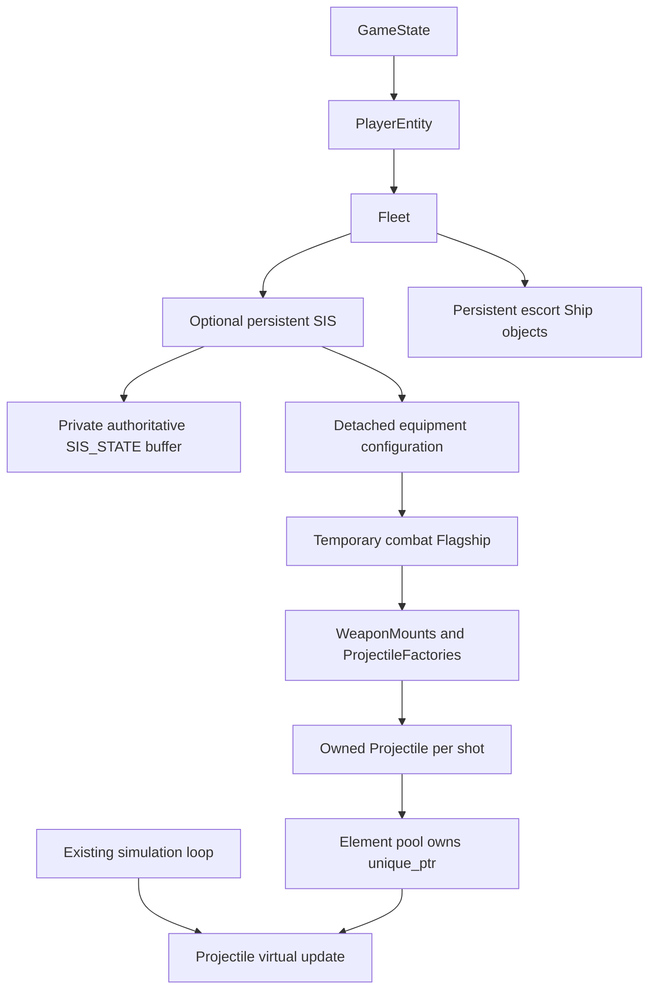

# Fleet-owned SIS and projectile factories

The persistent Precursor vessel is `uqm::SIS`. Fleet owns it as an optional value,
separate from the twelve escort slots. Campaign player fleets construct it with
`SISPresence::Present`; enemy and Super Melee fleets can omit it. `Fleet::sis()`
returns an optional reference wrapper, const when the fleet is const. PlayerEntity
has a mandatory convenience borrow because its constructor always creates a
campaign fleet with an SIS. Absence describes fleet composition, not death: a
defeated campaign SIS remains present with its defeat marker. Fleet and
PlayerEntity cannot move, keeping borrows
stable through synchronous child modes.

## Persistent state

SIS owns the same fuel, crew, equipment, cargo and names previously embedded in
GLOBDATA. The buffer still includes some legacy player/display fields such as
resource units, logical coordinates and the current planet label; their broader
classification is separate work. There is one authoritative record, not a
synchronized copy. `ShipState` is only a detached snapshot.

The C buffer accessor `GetPlayerSISState()` is implemented in game_state.cpp;
`GLOBAL_SIS` delegates to it. Save/load, Melnorme's temporary state copy and menu
save previews read/restore that same buffer without replacing the owning object.
InitGlobData resets the buffer explicitly alongside the remaining compatibility
payload. Escort clearing does not reset or remove the SIS. Save encoding and
SIS_STATE field widths are unchanged.

Fuel/crew setters store quantities; existing gameplay code owns capacity, payment
and reward policy. Persistent crew excludes the captain. Combat crew includes
the captain, so `recordCombatCrew(1)` means a living captain with zero crew,
whereas zero combat survivors restores the legacy 65535 defeat marker.
The combat Flagship borrows the persistent vessel and story state. Its explicit
finish hook commits crew; merely destroying an incompletely loaded incarnation
does not publish gameplay effects. HyperSpace incarnations do not commit combat
crew, and Super Melee incarnations do not write campaign crew.

## Mounts and factories

`configureSISWeapons` is a pure function of a detached SISLoadout and the blaster
profile loaded from ships.json. It builds at most six mounts: nose, paired
spread, paired sides and rear. Gun tier supplies damage/hit points, lifetime,
frame selection and energy cost; installed tracking modules set steering cadence.
Other module effects (crew pods, reactors, engines, turning and point defense)
retain the existing implementation in sis_ship.cpp.

Each mount owns a ProjectileFactory configured by value. At firing time the ship
supplies position and heading; the mount calculates muzzle position, direction
and velocity. Native callers can supply an explicit ProjectileLaunch instead.
Inherited velocity is optional and weapon-specific; SIS blasters do not inherit
ship momentum. Factories return unique_ptr<Projectile>, and each shot owns its
configuration and timer even if its firing mount/incarnation disappears.

The default native projectile uses direct steering: one existing facing step
(22.5 degrees) per steering interval, with velocity redirected immediately. It
retains the shared TrackShip target-selection helper and arena wrapping. Zero
tracking means no guidance; one/two/three trackers turn every four/three/two
ticks. The low/high-nibble turn timer and the SIS MISSILE_BLOCK array are removed.
Projectile is a conventional polymorphic base; specialized flight behaviors can
be added without coupling them to the firing ship's lifetime.

## Engine boundary and ownership

`publishProjectile` in projectile_legacy.cpp translates initial values to the
existing missile/render representation and transfers ownership to the element
pool. Allocation exhaustion destroys an unpublished projectile automatically.
The adapter preserves first-frame movement compensation and the existing visual
and collision callbacks. It invokes visual updates and then the native flight
update in the same order as the former SIS callback.

QueueStorage uses a vector of unique_ptr owners for ELEMENT slots. FreeLink,
ReinitQueue and destruction release those owners automatically, including
speculative AI shots and unlinked allocations. Ownership is not stored in the
copyable C ELEMENT record, so prediction copies do not duplicate ownership or
double-delete behavior. Pool addresses, fixed capacity and C handle layout are
unchanged. The native pool accessor is an internal borrowed C-buffer service.

The element engine remains responsible for position integration, collisions,
damage, expiration, rendering resources and safe removal timing. The native
object owns flight behavior, not a second physics state. Destruction is cleanup,
not a request to detonate or spawn effects. Sprites remain borrowed under the
existing ship/engine asset lifetime rules.

This production increment migrates SIS blasters. Other races' projectile
callbacks, SIS point defense and the full native Battle wireframe are not migrated
by this change; there is no new parallel battle simulation.

## Verification

Boost.Test covers optional SIS ownership and C/native visibility, crew/captain
conversion, mount expansion and tracking tiers, independent shot timers, explicit
launch/inherited velocity, validation of derived quantities, and real pool/adapter
ownership with simulated targeting/graphics allocation. It also checks that a
shot outlives its factory, copied engine records do not copy native ownership,
and free/reset/destruction and allocation exhaustion clean up exactly once.
Build, sanitizer and focused GUI results are recorded in the PR.

The launch/inherited-velocity tests also exposed a legacy negative signed-shift
in WORLD_TO_VELOCITY. Multiplication by the same scale now preserves those
components without undefined behavior.
