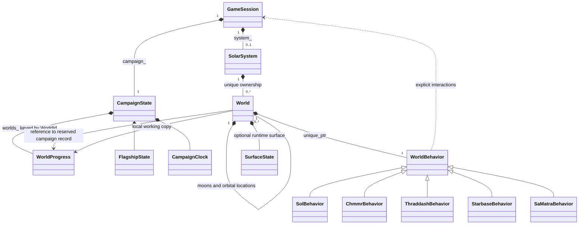
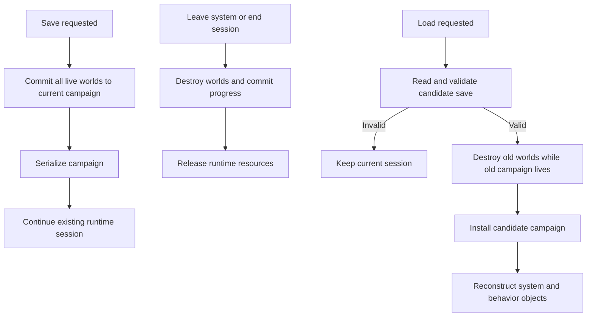

# Solar-system and campaign architecture wireframe

This is a **declaration-only C++17 design sketch**, not a gameplay implementation.
Nothing here is included in CMake, a legacy source manifest, or an existing game
file. Non-template methods intentionally have no definitions: this sketch can
be syntax-checked, but it is not a linkable replacement for today's gameplay.
It does not instantiate a second campaign alongside `GlobData`.

Start with `campaign_state.hpp` for persistent data, `world.hpp` for ownership,
`world_behavior.hpp` for the virtual hierarchy, and `game_session.hpp` for the
running session and save/load boundary. The only existing project dependency is
the C++ `StarId`/`StarDesc` declaration in `uqm/star_map.hpp`.



## State and ownership

CampaignState is the persistent owner. It groups story flags, bounded counters,
flagship data, fleet progress, calendar/events and per-world collection masks.
Its containers are private. `read(StoryFlag)`, `set(StoryFlag)`, `clear(StoryFlag)`
and overloaded counter operations express the small state interface discussed.
Only representative fields are listed; this is not a complete schema.

Counter values calculated during gameplay need runtime range validation.
Constant fields/values may use `set<StoryCounter::BombProgress, 3>()`, with a
compile-time check. Four is invalid for the existing two-bit bomb state. We do
not change or reinterpret that state machine in this design.

WorldId is the key `(StarId, planet slot, optional moon slot)`, not a hash value.
An unordered_map may hash it internally and still compare the full key. Save
formats store its components. Slots must stay stable across generation: current
orbital drawing order is not identity. Additional location identities will need
an explicit decision when moving beyond existing planet/moon slots.

Only one World for a given WorldId may be alive in a session; the builder must
enforce this to avoid competing working copies. Each live World owns a working
WorldProgress copy. Its campaign record is created
before the world is published, and a reference to that record is retained. An
unordered_map rehash does not invalidate element references, but erasing a record,
assigning over the campaign or destroying it would invalidate this relationship.
CampaignState is therefore not replaced while worlds are alive. Commit copies
only three fixed-size bitsets to the reserved record, without allocation, file
I/O or handlers. Normal destruction can safely use the same noexcept operation.

World objects cannot be copied or moved: destroying a moved-from world must not
commit an obsolete progress snapshot. Their unique_ptr owners can move safely.
The session owns the campaign before the system in declaration order, ensuring
world destruction precedes campaign destruction. The campaign itself is heap
owned so its address remains stable during session setup and replacement.

Surface creatures, movement, hit points and stunned conditions are temporary.
A retrieved node changes the world's working mask; cargo changes separately
update campaign inventory. Committing world masks does not duplicate cargo.
Saving must capture the live world rather than serialize a stale campaign record.

## Construction, generation and interactions

A definition supplies identity, name, kind, seed and initial physical properties.
Construction establishes ownership and progress records; it does not start a
conversation or battle. `generateSystem` and generation methods are explicit,
initially delegating existing algorithms and preserving RNG consumption.
Moons and orbital locations can be children. Surface nodes are typed data,
not another generic node/class hierarchy. No support for moons of moons is
required for UQM's current content.

World owns a non-null `unique_ptr<WorldBehavior>`. The base is concrete and
supplies ordinary behavior; derived classes override exceptions. There is no
std::function/lambda dispatch layer or type-erasure machinery. The behavior
factory selects from the existing star special-system ID and world definition.
Its implementation can preserve today's gendef.c switch routing.

Calling `world.enterOrbit(session)` dispatches to the behavior's virtual method.
Handlers query `session.campaign()` at invocation time. They do not cache the
outcome of story conditions during construction, and they do not retain references
to a temporary generation context. Chmmr shielding and encounters depend on live
story state. Shielding/landing permissions and story interaction are separate:
ordinary orbit does not automatically launch a lander.

These subclasses illustrate the topology; exact hook placement still needs an
audit of each current generator. System-wide NPC initialization/reentry/cleanup
hooks remain an explicit migration boundary; this sketch does not pretend they
are world-surface operations. A dedicated system behavior may be warranted after
that audit. Reuse existing conversations, battles, lander and rendering code
through a C adapter; raw pointers, C structs and packed save fields stay there.

## Save, leave and load



Commit is idempotent: explicit saving followed by later destruction is safe.
Serialized state contains facts and stable IDs, not pointers, virtual tables,
unique_ptr representations or handlers. Loading reconstructs those objects.
Allocation/asset failures during reconstruction, atomic file replacement, and
how to retain old save compatibility remain design work for the actual migration.
The wireframe does not claim transactional recovery for those cases.

## Incremental implementation boundary

1. Audit persistent fields and old save encodings; define the full flag/counter
   schema and stable world/location IDs before replacing storage.
2. Add campaign/progress ownership with a C adapter and one authoritative store.
3. Implement the default world behavior and migrate one ordinary world path.
4. Migrate a special case such as Chmmr, then expand the derived hierarchy.
5. Retire function tables and old global access only as their callers migrate.

Syntax-check the declaration sketch from the repository root:

```sh
printf '#include "game_session.hpp"\n#include "world_behavior.hpp"\n' | \
  g++ -std=c++17 -Wall -Wextra -Wpedantic -fsyntax-only -x c++ \
  -Isc2/src -Idocs/design/solar-system -
```
