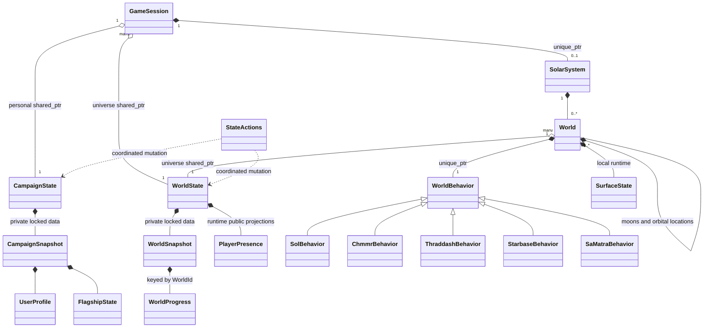
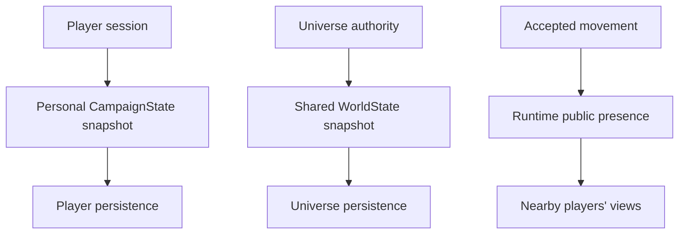

# Personal campaign, shared universe, and world behavior wireframe

This is a **declaration-only C++17 design sketch**, not a gameplay implementation.
It adds no production integration, threads, locking implementation or networking.
Non-template methods intentionally have no definitions: syntax-check these headers,
but do not try to link them into the game. No second state store runs alongside
GlobData. Existing game sources and build manifests remain unchanged.

Read [CampaignState](campaign_state.hpp) for a player's portable information,
[WorldState](world_state.hpp) for shared universe facts and public presence,
[World](world.hpp) for local runtime ownership, [WorldBehavior](world_behavior.hpp)
for virtual dispatch and [GameSession](game_session.hpp) for their connection.
[Common types](state_types.hpp) contain only values and stable IDs.



## Personal versus shared information

| Owner | Representative information |
|---|---|
| CampaignState, one per user | UserProfile, ship/cargo/equipment, escorts, personal story flags/counters, visited-world knowledge, personal scheduled events |
| WorldState, shared universe | Physical world flags, retrieved-node masks, NPC fleets, authoritative calendar/events |
| WorldState public presence | Accepted player position, display name, facing, space/system/world coordinate frame |
| World / GameSession runtime | Current view and interaction, local surfaces, behavior object, rendering and input |

A shared WorldState does not contain all private player campaigns. Each campaign
encapsulates one stable PlayerId and display profile. UserProfile contains no
passwords, authentication credentials, socket or UI object. Personal snapshots
can be saved, loaded or hosted independently of runtime sessions later.

These are representative fields, not a final story schema. Freeing the Chmmr is
shown as a shared physical WorldFlag; carrying the Sun Device is personal. We
still need to decide which legacy quest/dialogue counters are personal, shared
or instanced. World generation receives shared world state so all players see
the same physical layout; personal conditions affect their interactions rather
than silently creating contradictory shared geography.

UniverseId binds a campaign's visited-world IDs and story policy to an instance.
WorldId is `(StarId, planet slot, optional moon slot)` within that instance, not
a hash/address or drawing order. Cross-universe campaign transfers need an
explicit compatibility policy for identities, seeds, progress and deadlines.
A stable identifier in this sketch does not define its final UUID/wire format.

For example, two users can join the same universe with separate campaigns:

```cpp
auto universe = std::make_shared<WorldState>(UniverseId{1});
auto alice = std::make_shared<CampaignState>(UserProfile{PlayerId{1}, "Alice"});
auto bob = std::make_shared<CampaignState>(UserProfile{PlayerId{2}, "Bob"});
alice->bindUniverse(UniverseId{1});
bob->bindUniverse(UniverseId{1});
GameSession aliceSession{alice, universe};
GameSession bobSession{bob, universe};
```

A session's identity comes from its campaign. It must not supply an unrelated
PlayerId that could disagree with the state receiving rewards.

## Lifetime and synchronization

Sessions hold shared_ptr copies of their personal campaign and the shared
universe. Worlds hold only the shared WorldState, not a particular user's
campaign. Behavior methods receive a GameSession when someone interacts and
query both `session.campaign()` and `session.worldState()` as needed.
State objects own no sessions or worlds back, so this topology has no ownership
cycle. Local worlds, children and behavior objects remain uniquely owned.

**shared_ptr protects lifetime, not mutable data.** Each state owner reserves a
private mutable shared_mutex. Implementations must use shared_lock for queries
and unique_lock for mutations. No internal mutable record/reference or lock guard
escapes. Queries return copied values. Snapshot methods copy one owner's data
under a read lock, then release it before serialization. Mutexes, pointers,
handlers and ownership representations are never saved.

Each session/World remains simulation-thread confined. Workers receive their own
shared_ptr copies; racing access to the same session's attachment member still
needs synchronization. Callbacks, rendering, networking and disk I/O must not run
under either state mutex, and methods must not recursively call another public
lock-taking method while holding its lock.

The typed flag/counter overloads remain: `read(StoryFlag)`, `set(StoryFlag)`,
`clear(StoryFlag)` and bounded counter operations on the personal campaign;
WorldFlag operations live on WorldState. Constant bomb progress 3 compiles with
`set<StoryCounter::BombProgress, 3>()`; 4 is invalid for the current two-bit field.

## Atomic collection across the two owners

Claiming a shared mineral while adding cargo to a personal ship crosses the
state boundary. Locking either object alone is insufficient.
StateActions::tryCollect must lock both owners together with std::scoped_lock,
validate the player/universe binding, eligibility and capacity, then update the
shared mask and personal reward as one in-memory operation. A second claim
awards nothing. Update private fields directly under the guards, not by calling
public methods that would reacquire these non-recursive mutexes. Story eligibility
is resolved by the authoritative interaction path; callbacks run outside locks.

Rewards are computed by trusted simulation code, not accepted from a network
client. The coordinator does not make two separately persisted files or services
transactional. Independent/containerized services will need an authoritative
command/transaction protocol, consistent checkpointing and retry/idempotency
rules. The sketch does not implement those mechanisms.

WorldProgress contains three collected-node bitsets. Runtime progress copies are
presentation/checkpoint caches, never authority. Confirmed permanent bits may be
OR-merged without awarding cargo again; replacing a record could erase another
player's progress. Future respawn/reset operations need a separate versioned
policy so stale checkpoints cannot reapply cleared bits. Shared claims are
published when accepted, not first in a destructor. Save/leave checkpointing is
explicit and may throw; destructors only clean up runtime objects.

## Seeing other players

WorldState keeps a separate runtime presence map keyed by PlayerId. The authority
publishes accepted movement in an explicit coordinate frame. `nearbyPlayers`
returns only the permitted public projection, allowing a client to draw other
ships without receiving those users' inventories, quest flags or private saves.
Presence is not part of the persistent WorldSnapshot and is rebuilt when users
connect. Disconnect/reconnect handling must reject stale-session updates/removals.

Presence data alone does not implement co-op. The authority still needs active
world simulations and replication for creatures, landers, encounters and battles,
plus visibility rules, update ordering and interpolation. Rendered remote ships
would be local views of accepted presence, not direct access to another process's
CampaignState object.

## Construction and conventional OOP dispatch

World construction establishes physical/local data and shared universe ownership;
it does not launch a story. generateSystem initially adapts existing generation
algorithms with unchanged seed coercion/draw order. Planets can own moons and
orbital locations; surface nodes remain typed data. No moons-of-moons support is
required by current content.

Each World owns a non-null unique_ptr<WorldBehavior>. The concrete base supplies
normal generation/orbit/pickup methods; derived classes override special cases.
The factory uses StarDesc's special-system ID and the world definition, preserving
the gendef.c switch routing concept. No lambda/type-erasure layer is introduced.
An interaction reads both current personal and shared state; it never caches a
construction-time story decision. Shielding/landing permission and story dispatch
remain separate. Normal orbit does not automatically launch a lander.

These subclasses are illustrative. System-wide NPC initialization/reentry/cleanup
and the exact migration of current generator hooks still need an audit. C adapters
would keep old structs, raw buffers and packed save fields outside these classes.

## Save, load and deployment boundaries

A player's save serializes their CampaignSnapshot; the host persists WorldSnapshot
separately. A private save/load cannot rewind shared collected minerals or replace
the universe for other users. Online restoration and cross-owner checkpoints need
host coordination to preserve reward/claim consistency. Snapshots should be taken
at defined authoritative action/tick boundaries, not midway through a story action.



Validate candidate personal saves and identity/universe bindings before changing
a session. Tear down that session's runtime, attach the approved state and rebuild.
Other users retain their campaigns and the shared universe. A retained shared_ptr
keeps old data alive; it does not authorize late commands against a reattached
session. Authentication, campaign/session generations and access checks belong at
the authority boundary.

Encapsulation permits later per-user storage or service/container deployment, but
remote processes do not share C++ pointers or mutexes. They exchange IDs, snapshots
and validated commands. No Docker layout, wire protocol, database or networking
framework is selected here. Reconstruction failure recovery, legacy save mapping,
quest-sharing policy and distributed transactions remain implementation work.

## Incremental implementation boundary

1. Audit legacy state/save fields and assign each to personal, shared or runtime
   scope. Define stable world/location and player/universe identities.
2. Implement state owners and adapters with lock-scoped snapshots and coordinated
   collection, keeping one authoritative owner for each fact.
3. Add default world behavior and one ordinary world path, then a special case.
4. Add presence publication/views before attempting full shared active simulation.
5. Retire global/function-table access only as corresponding callers migrate.

Syntax-check each header from the repository root:

```sh
for header in state_types.hpp campaign_state.hpp world_state.hpp world.hpp \
              world_behavior.hpp game_session.hpp; do
  printf '#include "%s"\n' "$header" | \
    g++ -std=c++17 -pthread -Wall -Wextra -Wpedantic -fsyntax-only -x c++ \
    -Isc2/src -Idocs/design/solar-system - || exit 1
done
```
