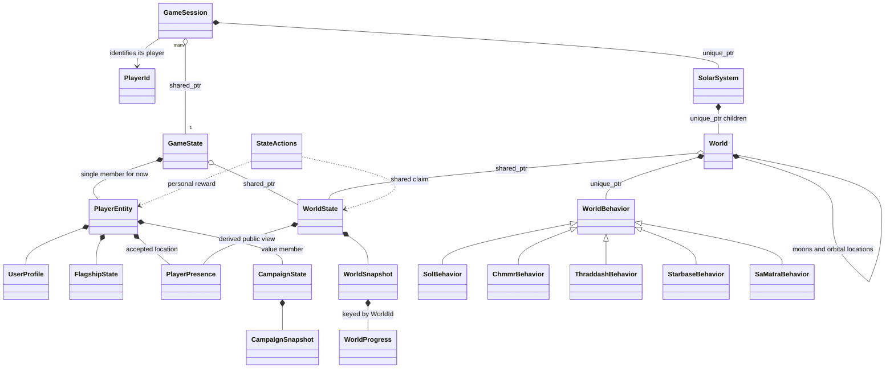

# Game state, player entities, and world behavior wireframe

For the live system-level implementation, see [SystemBehavior migration](system-behavior.md):
scoped exploration ownership, a borrowed campaign reference, default hooks, all special-system overrides, and the remaining C engine bridge.

The headers in this directory remain a **declaration-only target design**. Do
not link them into the game. The first production step now lives in
[`sc2/src/uqm/game_state.hpp`](../../../sc2/src/uqm/game_state.hpp): checked player
lookup, shared session ownership, a player-owned legacy payload, native ship and
location values, and typed personal story access. See [implementation status and
migration contracts](../../game-state.md).

The production GameState now also owns a shared_ptr<WorldState> holding the
legacy scan/NPC file buffers with vector storage and copied snapshots. These
archives still contain some personal history. The new
[physical changes versus personal discovery wireframe](discovery-state.md)
explains the required semantic split before multiplayer sharing or typed world
progress replaces the archive.

The production layer deliberately retains the existing mixed GLOBDATA layout
behind its C adapter. Typed physical WorldProgress access and generated-layout validation are now
implemented behind the legacy format. Full story-field extraction, a new portable
snapshot format and networking
remain future work. Native World/SolarSystem runtime ownership and polymorphic
[energy behaviors](energy-behavior.md) now run in the game; the broader
WorldBehavior generation/orbit hierarchy below remains a target.
The sketches use a separate namespace and illustrate the destination; their
signatures are not a second production API or a second live state store.

The production [mode dispatcher and load boundary](orbit-entry.md) now unwind
menus and synchronous gameplay before replacing campaign data. Native menus use
optional exit results; C flags remain compatibility unwind signals. This replaces
the earlier epoch/shared-policy proposal for synchronous loading. Orbital behavior
conversion can proceed within that lifecycle contract.

Start with [GameState](game_state.hpp), the storage boundary, and
[PlayerEntity](player_entity.hpp), the complete personal state owner.
[CampaignState](campaign_state.hpp) holds personal story progress by value inside
that entity. [WorldState](world_state.hpp) holds shared universe facts.
[GameSession](game_session.hpp) connects a player identity to runtime interaction.
[World](world.hpp) owns local world data and [WorldBehavior](world_behavior.hpp)
provides conventional virtual dispatch. [Common types](state_types.hpp) are values.



## Hide storage, preserve ownership

GameState initially owns exactly one PlayerEntity. Its checked `player(PlayerId)`
lookup returns that entity or throws std::out_of_range for an unknown identity.
No player list, map, iterators, storage indices or single/multiplayer mode checks
appear in the session interface. A collection can replace the private member
later without changing how callers identify their player. No inheritance layer
or separate single-player implementation is required now.

```cpp
auto universe = std::make_shared<WorldState>(UniverseId{1});
auto state = std::make_shared<GameState>(
        UserProfile{PlayerId{1}, "Captain"}, universe);
GameSession session{state, PlayerId{1}};
```

The constructor validates the ID against the supplied state. Each session retains
its GameState owner and looks up its own player when needed. It does not cache a
player pointer or hold a separately owned campaign. GameState owns no session
back, so there is no ownership cycle. Borrowed player/campaign references last
only for the current simulation operation; callers must not retain them across
load, removal, transfer or storage changes. shared_ptr preserves the state owner's
lifetime, not a player's membership or permission to execute a late command.

| Owner | Representative information |
|---|---|
| PlayerEntity | Immutable player identity, display profile, accepted location, ship/cargo/equipment, personal CampaignState |
| CampaignState inside PlayerEntity | Personal story flags/counters, escorts, visited-world knowledge, personal events |
| WorldState | Physical world flags, retrieved-node masks, NPC fleets, authoritative calendar/events |
| WorldState public presence | Derived display name/location/facing for visible players |
| World / GameSession runtime | Current view, local surface data, behavior objects, rendering/input |

Identity/profile and ship data have one authoritative home in PlayerEntity.
CampaignState contains story progress, not another copy of the user or ship.
UserProfile has no passwords, credentials, sockets or UI objects. The public
presence record is a projection: its identity/name must match the owning entity,
not independently supplied client claims. It excludes inventory and story flags.

These fields are representative, not a final story schema. Freeing the Chmmr is
shown as a shared WorldFlag; carrying the Sun Device is personal. The exact scope
of legacy quest/dialogue counters still needs an audit. World generation receives
shared state; personal conditions affect interactions rather than silently
creating contradictory shared geography.

UniverseId binds personal progress to an instance. WorldId is `(StarId, planet
slot, optional moon slot)` within that universe, not a hash, address or drawing
order. Transfers need an explicit compatibility policy for IDs, seeds, progress
and deadlines. These IDs do not specify a final UUID or wire representation.

## Access and synchronization contracts

The GameState facade, player entities and sessions are simulation-thread confined.
Mutable player/campaign references are local borrowed access on that thread;
they are not a thread-safe or remote API. Workers receive detached snapshots.
PlayerEntity is the future synchronization boundary for its entire personal state,
including campaign and cargo. We do not introduce separate locks that could let
one player's ship and campaign be observed halfway through the same action.

WorldState retains its private shared_mutex placeholder: implementations use
shared_lock for copied queries and unique_lock for mutations. Public mutable
world records and lock guards do not escape. Story callbacks, rendering, disk I/O
and networking must run outside state locks. Snapshot serialization happens after
copying data and releasing locks. Mutexes and ownership pointers are never saved.

shared_ptr protects lifetime, not mutable data. Adding worker mutation later
requires coordinated locking around both PlayerEntity and WorldState, plus a
snapshot-only worker interface. It cannot simply make existing borrowed references
safe. Runtime World objects remain thread confined and uniquely owned.

Typed personal flag/counter overloads remain: `read(StoryFlag)`, `set(StoryFlag)`,
`clear(StoryFlag)` and bounded counters. Constant bomb progress 3 compiles with
`set<StoryCounter::BombProgress, 3>()`; 4 is invalid for the current two-bit field.
Shared physical flags use WorldFlag operations on WorldState.

## Collection and other cross-owner actions

GameSession routes accepted actions through GameState. StateActions::tryCollect
coordinates the player entity's cargo and the universe's collected-node mask.
Validate identity/universe binding, eligibility, node and capacity, then apply
both changes as one authoritative action. A second claim awards nothing. Rewards
are calculated by trusted simulation code, not supplied by a network client.

Initially this runs on the single authoritative simulation thread with the world
mutation guarded. If player mutation becomes concurrent, lock player and world
together with std::scoped_lock; do not acquire them in inconsistent orders or call
public lock-taking methods while holding their non-recursive locks. Callbacks run
outside locks. The current declarations do not implement either policy.

WorldProgress contains three permanent collected-node bitsets. Runtime copies
are presentation/checkpoint caches. OR-merge confirmed bits without awarding
cargo again; never replace progress with a stale copy. Respawn/reset needs a
separate versioned policy. Claims publish when accepted, not in destructors.
Explicit checkpointing may throw; destructors only clean up runtime resources.
In-memory coordination does not make separate files or services transactional.

## Public presence and eventual multiplayer

PlayerEntity owns its accepted location. GameState::updatePresence validates the
player binding and updates both that location and WorldState's derived public
presence at an authoritative action boundary. The presence index is not a second
independently editable ship/location store. It is rebuilt from active entities,
not restored as part of WorldSnapshot. nearbyPlayers returns copied public views.
Disconnect/reconnect handling must reject stale updates/removals.

This allows visibility code to ask about nearby ships without knowing player
storage. Presence alone does not implement co-op: active creature, lander,
encounter and battle simulation, authority, ordering, interpolation and network
replication remain future work. Remote processes exchange IDs, commands and
snapshots, not C++ references, pointers or mutexes. A remote adapter will therefore
sit at a command/snapshot boundary rather than pretending `player(id)` is a
network lookup. No networking framework, database or container layout is chosen.

## World construction and behavior

Worlds retain shared WorldState ownership, not a particular PlayerEntity.
Behavior methods receive the interacting GameSession and query its current
campaign and shared world state. World construction establishes physical data;
it does not launch a story or cache construction-time story decisions.

Each World owns a non-null unique_ptr<WorldBehavior>. The concrete base supplies
normal generation/orbit/pickup hooks; derived classes override special cases.
The factory uses StarDesc's special-system ID, preserving the gendef.c dispatch
concept without a lambda/type-erasure layer. Shielding and landing permission
remain separate from story dispatch. Normal orbit does not launch a lander.

Planets own moons and orbital locations; surface nodes remain typed data.
No moons-of-moons support is needed by current content. Generation initially
adapts existing algorithms and seed/draw order. System-wide NPC hooks and exact
legacy callback migration still need an audit. C adapters would isolate old
structs, raw buffers and packed save fields from these interfaces.

## Save and load boundaries

A personal save contains PlayerSnapshot: profile, universe binding, accepted
location, ship and nested CampaignSnapshot. GameSession::save obtains it through
GameState. The host separately persists WorldSnapshot. Copy snapshots at an
authoritative action/tick boundary, not halfway through a reward or story action.
The combined personal/shared checkpoint still needs coordinated persistence.

Validate a candidate's identity and universe binding before changing state. Tear
down the session's runtime, restore the selected entity in place through GameState,
and rebuild runtime views. Restoring one player's save cannot rewind shared
minerals, replace the universe or overwrite another player. Online restoration
requires authority checks and replay/reward consistency. Stale commands must be
rejected even when a shared_ptr keeps an old owner alive.

## Incremental implementation

1. Audit legacy fields into player, campaign, shared-world and runtime scopes.
2. Implement the single-player GameState boundary and PlayerEntity adapters.
3. Add coordinated actions and snapshot persistence with one owner for each fact.
4. Migrate default world behavior and one ordinary path before special cases.
5. Replace private player storage only when multiple active players are needed.

No legacy call sites or save formats are migrated by this wireframe.
Syntax-check each header from the repository root:

```sh
for header in state_types.hpp campaign_state.hpp world_state.hpp player_entity.hpp \
              game_state.hpp world.hpp world_behavior.hpp game_session.hpp; do
  printf '#include "%s"\n' "$header" | \
    g++ -std=c++17 -pthread -Wall -Wextra -Wpedantic -fsyntax-only -x c++ \
    -Isc2/src -Idocs/design/solar-system - || exit 1
done
```
