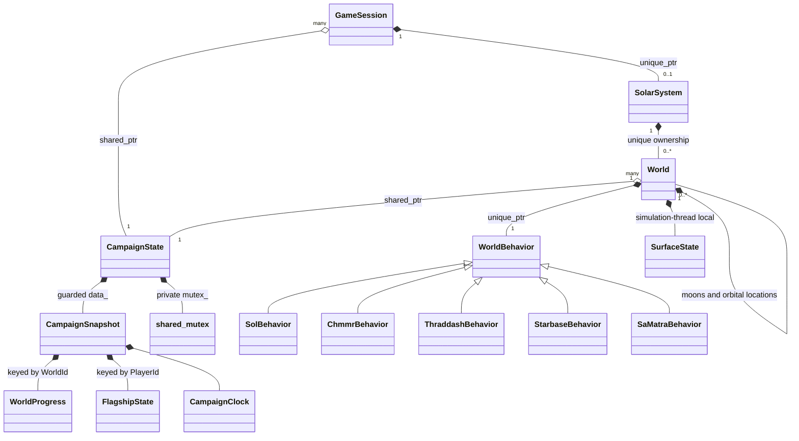
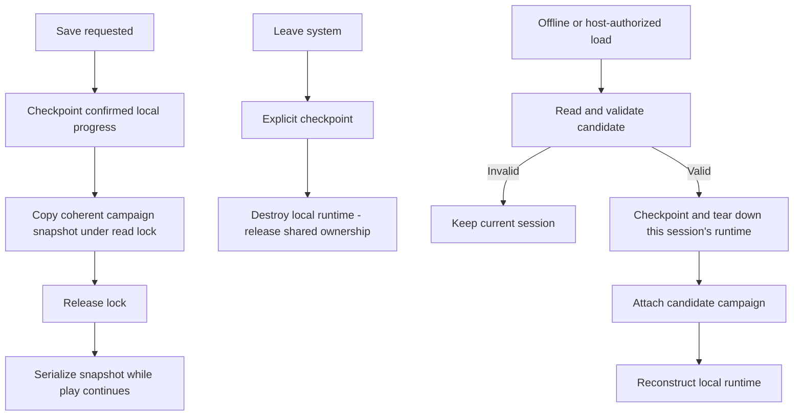

# Solar-system and campaign architecture wireframe

This is a **declaration-only C++17 design sketch**, not a gameplay implementation.
Nothing here is included in CMake, a legacy source manifest, or an existing game
file. Non-template methods intentionally have no definitions: this sketch can
be syntax-checked, but it is not a linkable replacement for today's gameplay.
It does not instantiate a second campaign alongside `GlobData`.

Start with `campaign_state.hpp` for persistent data, `world.hpp` for ownership,
`world_behavior.hpp` for the virtual hierarchy, and `game_session.hpp` for the
running session and save/load boundary. The only existing project dependency is
the C++ `StarId`/`StarDesc` declaration in `uqm/star_map.hpp`.



## Shared state and synchronization contract

GameSession and World each retain a non-null `shared_ptr<CampaignState>`. Several
players/sessions may attach to the same campaign, and a world or outstanding job
can retain the old campaign after one session detaches. CampaignState does not
own sessions or worlds: there is no strong-reference cycle. A later callback
that needs a session should use a weak_ptr or an explicit queued ID rather than
create a cycle. Worlds, children and behavior objects still use unique ownership.

**A shared_ptr keeps an object alive; it does not make that object thread-safe.**
Different shared_ptr copies can share ownership safely, but racing reads/writes
of the same session's shared_ptr member still requires synchronization. The
session, World, behavior and local surface objects remain simulation-thread
confined. A task receives its own shared_ptr copy before being handed to another
thread; it cannot concurrently change a session's attachment or local runtime.

CampaignState reserves a private `mutable std::shared_mutex`. Future method bodies
must use `std::shared_lock` for reads and `std::unique_lock` for writes. Containers
stay private. Queries return value snapshots, not references into containers after
a lock has been released. Bool/counter reads and the 12-byte collection-mask copy
are small; larger snapshots deliberately copy vectors/maps when requested.
No lock guard or mutable record reference is exposed to callers.

`CampaignSnapshot` contains story flags/counters, per-world masks, per-player
flagships, fleet progress, a clock/event list and a revision. `snapshot()` copies
all these under one read lock, producing a coherent point-in-time save value.
Serialization happens after releasing the lock. Mutexes and ownership handles
are never serialized. This is a synchronization contract in declarations only:
there is no locking or concurrency implementation in this wireframe.

Multi-field mutations update private data under one guard; they must not call
another public lock-taking method and recursively acquire this non-recursive
mutex. Begin with one campaign mutex; finer-grained locking is a later measured
decision rather than a new lock hierarchy now.

For example, two local player sessions can retain the same campaign owner:

```cpp
auto universe = std::make_shared<CampaignState>();
universe->addPlayer(PlayerId{1}, FlagshipState{});
universe->addPlayer(PlayerId{2}, FlagshipState{});
GameSession alice{PlayerId{1}, universe};
GameSession bob{PlayerId{2}, universe};
```

World-wide facts such as freeing the Chmmr are shared StoryFlags. A ship-specific
fact such as SunDeviceOnShip is a PlayerFlag, and inventory/cargo is keyed by
PlayerId. The exact sharing policy of every existing story counter, quest and
ship flag still needs an audit. Only representative fields are listed; this is
not a complete multiplayer schema. Register players before querying their ships.

Counter values calculated during gameplay need runtime range validation.
Constant fields/values may use `set<StoryCounter::BombProgress, 3>()`, with a
compile-time check. Four is invalid for the existing two-bit bomb state.

WorldId is `(StarId, planet slot, optional moon slot)`, not a hash value. Save
formats retain the components; orbital drawing order is not identity. Additional
location identities remain a decision for the implementation phase.

## Collection and checkpoints

Two players may encounter the same node. A local WorldProgress copy must never
overwrite another player's collection or award the same mineral twice.
`tryCollect(player, world, node, reward)` therefore validates and claims the node
and grants the authoritative reward in one write-locked operation. The second
claim fails without cargo. Rewards are determined by trusted simulation code,
not accepted from a network client. Capacity checks and story eligibility must
be resolved by the authoritative interaction path.

World's progress is a presentation/checkpoint cache, not the authoritative record.
Queries can obtain fresh snapshots. Checkpoints OR only confirmed permanent
collection bits into shared state, never replace the whole record or grant more
cargo. This merge is idempotent. It cannot be used to undo/reset nodes or submit
speculative client claims. Respawns and resettable story nodes would need their
own versioned rules, so an old checkpoint could not reinstate a cleared bit.

This deliberately changes the earlier single-player destructor write-back sketch:
shared pickups are published when accepted, not first when a world is destroyed.
Save/leave operations explicitly checkpoint before teardown. A destructor only
releases runtime resources; it does not attempt a lock or a state write that can
throw. Mutex acquisition and allocation can fail, so checkpointing no longer
promises noexcept. No references to map records escape, and no allocator/rehash
lifetime assumptions are needed by World.

World objects cannot be copied or moved; their unique_ptr owners can move safely.
Their shared campaign member keeps the correct campaign alive independently of
session destruction order. Session attachment changes do not redirect old World
objects to a different campaign. Delayed actions must additionally validate a
campaign/session generation or authority token: memory lifetime is not permission
to execute an action after detachment.

Surface creatures, movement, hit points and stunned conditions remain temporary.
For actual co-op, an authoritative server will also need a shared live simulation
for each occupied world. Sharing campaign masks alone does not synchronize
creatures, landers, battles or other live objects.

## Construction, generation and interactions

A definition supplies identity, name, kind, seed and initial physical properties.
Construction establishes ownership and local presentation; it does not start a
conversation or battle. `generateSystem` and generation methods are explicit,
initially delegating existing algorithms and preserving RNG consumption.
Moons and orbital locations can be children. Surface nodes are typed data,
not another generic node/class hierarchy. No support for moons of moons is
required for UQM's current content.

World owns a non-null `unique_ptr<WorldBehavior>`. The base is concrete and
supplies ordinary behavior; derived classes override exceptions. There is no
std::function/lambda dispatch layer or type-erasure machinery. The behavior
factory selects from the existing star special-system ID and world definition.
Its implementation can preserve today's gendef.c switch routing.

Calling `world.enterOrbit(session)` dispatches to the behavior's virtual method.
Handlers retain the returned `session.campaign()` shared_ptr for the operation
and query its methods at invocation time. They do not cache the
outcome of story conditions during construction, and they do not retain references
to a temporary generation context. Chmmr shielding and encounters depend on live
story state. Shielding/landing permissions and story interaction are separate:
ordinary orbit does not automatically launch a lander.

These subclasses illustrate the topology; exact hook placement still needs an
audit of each current generator. System-wide NPC initialization/reentry/cleanup
hooks remain an explicit migration boundary; this sketch does not pretend they
are world-surface operations. A dedicated system behavior may be warranted after
that audit. Reuse existing conversations, battles, lander and rendering code
through a C adapter; raw pointers, C structs and packed save fields stay there.

## Save, leave and load



Detaching one session never destroys or silently replaces the campaign that
other players still use. An online universe save/load operation must be
coordinated by the authority; an individual client cannot roll back everybody.
Outstanding old-campaign references keep that old instance alive but may not
write into the new instance or run stale commands against the reattached session.
A save is a coherent state revision, not a globally paused set of runtime objects.

Serialized state contains facts and stable IDs, never mutexes, pointers, virtual
tables or handlers. Loading reconstructs runtime objects. Reconstruction failure
recovery, atomic file replacement and legacy save compatibility remain design
work; this wireframe makes no transactional recovery claim for those cases.

## Multiplayer direction, without building a networking framework

Use an authoritative host/server to own shared-universe decisions. Player
sessions submit identified commands; network I/O threads do not directly invoke
behavior methods or setters. The authority validates player permissions, campaign
instance and current conditions, then applies actions in a defined simulation
order. Story callbacks, networking, rendering and disk I/O run outside the state
mutex. A mutex protects data access, not the semantics of multi-step story rules.

Remote machines do not share a C++ shared_ptr or mutex. They need serialization,
replication, command validation, ordering, reconnect handling and a policy for
which quests/inventory/progress are shared. Campaign revision numbers leave a
place to identify snapshots, not an implemented replication protocol. Keep that
work outside this storage sketch rather than invent a framework now.

## Incremental implementation boundary

1. Audit persistent fields and old save encodings; define the full flag/counter
   schema and stable world/location IDs before replacing storage.
2. Implement shared campaign ownership, lock-scoped access/snapshots and atomic
   collection, with a C adapter and one authoritative store.
3. Implement the default world behavior and migrate one ordinary world path.
4. Migrate a special case such as Chmmr, then expand the derived hierarchy.
5. Retire function tables and old global access only as their callers migrate.

Syntax-check the declaration sketch from the repository root:

```sh
printf '#include "game_session.hpp"\n#include "world_behavior.hpp"\n' | \
  g++ -std=c++17 -Wall -Wextra -Wpedantic -fsyntax-only -x c++ \
  -Isc2/src -Idocs/design/solar-system -
```
