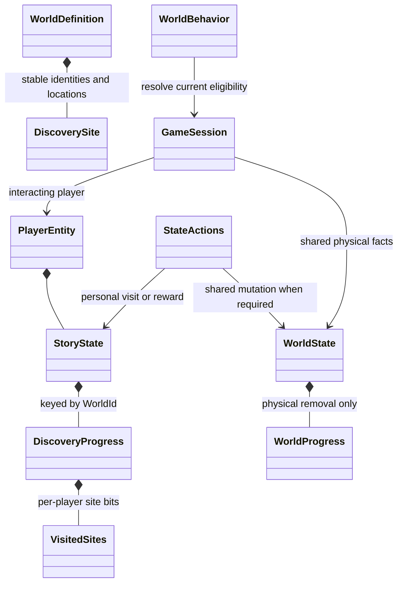
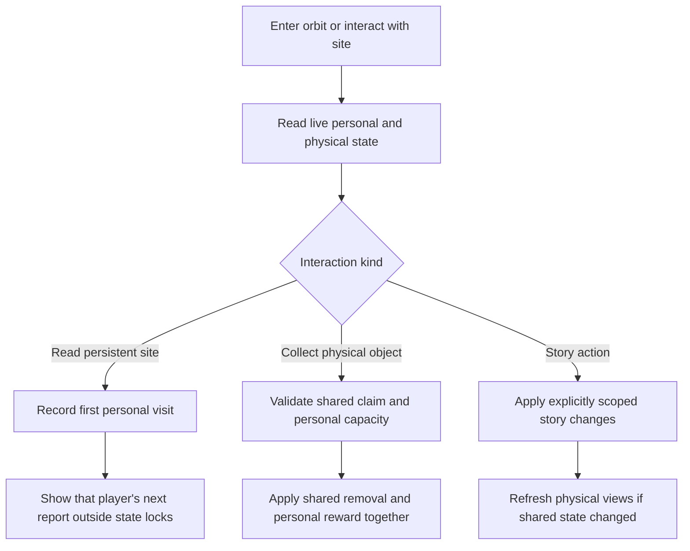

# Physical changes and personal discovery: additional wireframe

The first production discovery split is implemented in
[`world_types.hpp`](../../../sc2/src/uqm/world_types.hpp), the player's
StoryState, and the legacy planet-info adapter. Androsynth visits are personal
records keyed by stable WorldId; the site remains physically present. A visit is
recorded on acceptance before report UI, preserving existing behavior.

Legacy import is deliberately on demand, once the generated layout identifies
the report record. Unvisited records in an old checkpoint remain opaque until
then. Once imported, the personal bits are removed from the live physical record.
Saving composes a detached native-word copy with this player's report history in
the original upper bits, without changing the world archive. Relative layout
bindings survive save-block reordering and are cleared for a new/load campaign.
No new on-disk chunk or save version is needed. An explicit export failure protects
native discovery worlds that have no legacy layout from silently losing history.

The broader classification below still guides remaining story/encounter work.

## The legacy scan mask mixes two meanings

Ordinary mineral and biological retrieval bits record objects removed from a
world. But [genand.cpp](../../../sc2/src/uqm/planets/generate/genand.cpp) uses the upper
16 energy bits for visited Androsynth ruins. It clears the lower retrieval bits
so the ruins remain visible, counts visited ruins to select the next story
report, and returns false from pickup so the object is not removed.

Consequently, blindly treating all three 32-bit masks as shared depletion would
make one player's report history affect everyone. A bit position does not tell
us whether it means physical removal, personal knowledge, or a script-specific
marker. The production adapter now splits these known report bits on first access.
Other unclassified archive contents are not yet a multiplayer schema.

Other examples reinforce the distinction:

- [genchmmr.cpp](../../../sc2/src/uqm/planets/generate/genchmmr.cpp) reads the physical
  CHMMR_UNLEASHED fact when generating shielding, then combines it with personal
  SUN_DEVICE_ON_SHIP and bomb progress during orbital interaction.
- [genspa.cpp](../../../sc2/src/uqm/planets/generate/genspa.cpp) combines a physical
  shield state, retrieved creatures, personal mission/report handling, and a
  discovery artifact. Those fields need individual classification.
- [genmyc.cpp](../../../sc2/src/uqm/planets/generate/genmyc.cpp) updates artifact removal
  and on-ship possession together. Removing an object from a world is distinct
  from knowing about it or possessing it later.

These are verified dependencies, not a claim that all legacy quest flags have
already been audited. The three scan categories are insufficient as ownership
categories.

## Proposed ownership

| Information | Owner | Examples |
|---|---|---|
| Stable site definition | World definition | Ruin identity, physical position, discovery kind |
| Physical depletion/change | Shared WorldState | Mineral removed, animal captured, unique object removed, shield disabled |
| Knowledge and narrative progress | PlayerEntity's StoryState | Ruins visited, reports read, subject learned, personal quest stage |
| Possession | PlayerEntity ship/campaign | Artifact currently carried, minerals in cargo |
| Active interaction | GameSession/runtime | Report currently displayed, conversation, temporary stun |

One site can have both shared and personal progress. A mineral pickup removes a
shared node and awards one player's cargo. Reading an indestructible ruin marks
that player's visit and displays their next report without deleting the site.
Picking up a unique artifact removes it once and awards possession once; other
players can still learn about its removal without receiving another copy.



The target StorySnapshot now includes a per-world DiscoveryProgress map.
Its visited-site mask is separate from WorldProgress. A report sequence can
initially be derived from the number of distinct sites that player has visited,
matching the existing Androsynth behavior. Do not store a second independently
mutable report count unless a specific story requires one.

## Interaction contracts

Keep conventional WorldBehavior virtual methods and straightforward state
operations. There is no need for a general event framework or lambda registry.
A handler reads current personal and physical state, determines the concrete
operation, and applies it through the authoritative session path.



For Androsynth ruins, repeated visits by the same player produce no new report.
A different player can discover the same ruin independently. If display is
interrupted, presentation retries must not award progress twice; the implemented policy records the visit on acceptance before presentation,
matching legacy behavior. A later acknowledgement-based UI would need a separate
pending-report state rather than repeating the discovery mutation.

Callbacks and UI run after state mutations and outside locks. Save/checkpoint
runs at an authoritative action boundary. A physical claim and personal reward
must not be serialized halfway through as two unrelated successful operations.

## Stable identity and generation

Use `(UniverseId, WorldId, site index)` for persistent discovery identity. WorldId
uses catalogue StarId, planet slot and optional moon slot, not an address or
file offset. A site's stable index must survive revisits and must not depend on
which reports an individual player has already read.

Shared physical flags influence shielding and physical generation; personal
flags influence interaction eligibility and presentation. Audit each generator
before enforcing that rule. Existing callbacks read a combined global context,
so a wholesale conversion cannot infer the correct scope from their signatures.
This does not assert that existing planet/moon counts change with story state;
it requires checking layout and node identity dependencies during migration.

World definitions and per-player runtime views are separate from the authoritative
shared state. A shared physical transition must invalidate/update relevant live
views; a personal discovery must not regenerate someone else's world.

## Save compatibility and migration boundary

Legacy saves combine these concerns. Import/export must be an explicit adapter:

```text
Legacy single-player save + generated layout
    ├─ physical retrieval bits → WorldState progress
    ├─ personal site/report bits → active player's StoryState discoveries
    └─ ship possession and personal story fields → PlayerEntity
```

Classify mask meanings per special system/world before decoding them. For the
Androsynth ruins, map the upper energy bits to personal visited-site records;
do not publish them as shared object removal. Re-exporting an old single-player
save can compose its active player's personal history with physical bits. That
composed value is a temporary compatibility buffer, not another live authority.

The legacy state-file handles and existing save functions remain active until
this conversion is implemented and tested. Do not replace them with an untyped
OR-merge of all masks. Import the whole checkpoint consistently; online loading
of a personal save cannot rewind shared claims.

The next architectural review should settle discovery acknowledgement/replay,
unique story-item ownership or co-op sharing, and encounter-instance scope.
Random/NPC archive bytes may also mix persistent fleets and visit-specific
encounter state; sharing their storage does not decide which encounters are
shared. Those gameplay policies require an explicit design before their data is
split or the behavior hierarchy is integrated.
