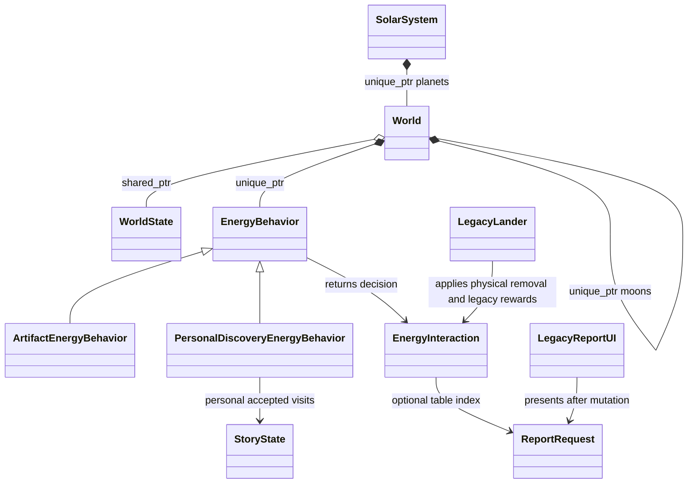

# Energy behavior composition

The production [EnergyBehavior](../../../sc2/src/uqm/energy_behavior.hpp) hierarchy
separates a surface site's interaction rules from physical generation, runtime
ownership, personal history and report UI. It is ordinary virtual dispatch;
there is no callback registry, type erasure, or function-pointer table here.

EnergyBehavior is a concrete no-op default. ArtifactEnergyBehavior accepts an
unretrieved site, requests its report and physical removal. It does not create a
personal discovery bit just because the object was collected. The authoritative
caller commits retrieval and reward together; the behavior's decision alone is
not a concurrent reservation or an inventory grant.

PersonalDiscoveryEnergyBehavior records the interacting player's first visit,
returns their next report index, and leaves the physical site in place. Repeated
visits by that player return no action. Another player has independent visits.
The behavior stores only site/report counts; all mutable progress lives in the
campaign. A new site can still be recorded after reports run out, matching the
legacy Androsynth sequence.

Both return a small EnergyInteraction value: accepted, removeNode and an optional
report index. This keeps UI callbacks and legacy save bits out of the policy.
A world attached to a generated system also checks its current persistent energy
bits, so a stale C view cannot re-award an already published artifact. The caller
still commits accepted removal and reward. Player mutation remains
simulation-thread confined. This is not yet a multi-player claim transaction.

## Active integration

The real game uses PersonalDiscoveryEnergyBehavior at the Androsynth ruins and
ArtifactEnergyBehavior for the Sun Device and three Mycon egg-case worlds.
Existing C handlers still load the report resources, run UI/takeoff, and update
their existing story/inventory fields. Existing lander code commits physical
retrieval. Generation and the rest of the encounter handlers remain in use.

[World](../../../sc2/src/uqm/world.hpp) owns its energy behavior and child worlds.
SolarSystem owns checked, stable-address planet objects. Shielding/landing checks
remain independent of the surface behavior. Starbases and Sa-Matra have explicit
world kinds. This is the first runtime tree, not a replacement terrain, rendering
or active-simulation model.

[world_c.cpp](../../../sc2/src/uqm/world_c.cpp) is the descriptor buffer boundary:
it copies generated planet/moon metadata into native WorldDefinition values and
owns a native SolarSystem behind an opaque C handle. Native classes retain no C
descriptor pointers. Rebuilding a system or moon list invalidates borrowed native
references, while campaign history and shared state survive. The handle is
explicitly destroyed after all system callbacks, including the debug traversal.
The future C++ session entry point can take over that unique ownership when the
C solar-system loop is migrated.

Definitions currently reflect generated metadata; C remains responsible for
rendering, generation and story changes. Future handlers must synchronize shared
physical transitions before using native landing decisions as game authority.

## Remaining story responsibilities

EnergyBehavior covers surface interactions. WorldBehavior will still handle
orbital encounters, shielding, starbases and system-level generation/NPC hooks.
A world can compose these responsibilities instead of growing a derived world
class for every combination of a planet, story and surface site.

More energy handlers can migrate independently. Complex sites such as Fwiffo
include damage, takeoff and conversations; their rules need explicit action/result
fields before migration rather than hiding the old callback inside std::function.
The existing world/campaign split and discovery persistence remain the owners of
state; adding a behavior does not choose co-op quest or item-sharing policy.
