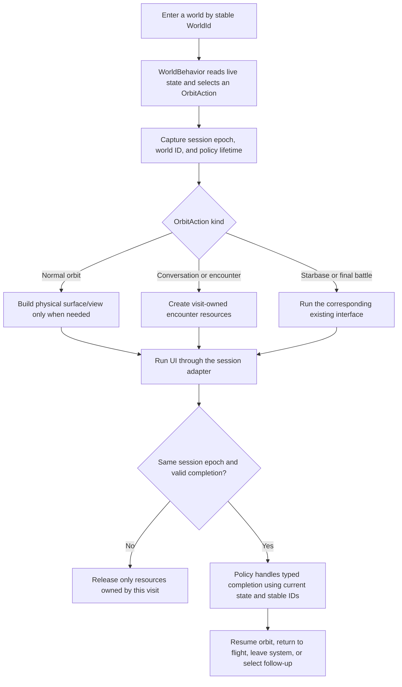
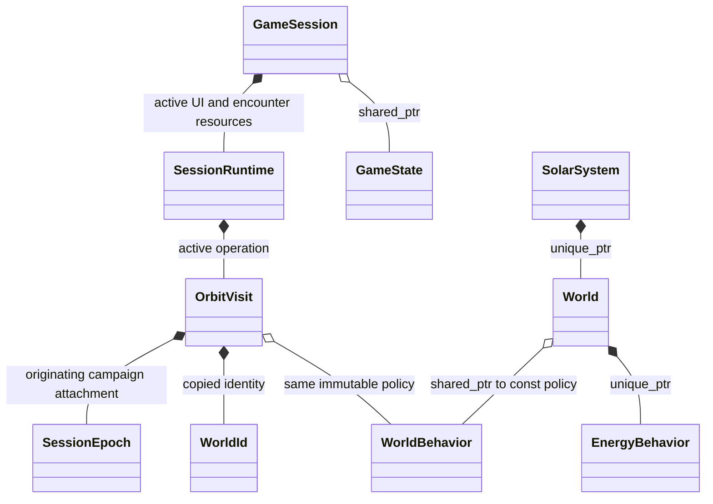

# Orbit entry, active visits, and replacement of a running session

This is the next proposed wireframe, not a production implementation. The native
World tree, EnergyBehavior hierarchy, discovery split and typed physical progress
already run in the game. Generation and orbital story callbacks still use the C
handler tables. Their migration needs an explicit visit-lifetime contract.

## The existing contract is hidden in control-flow flags

[generate.h](../../../sc2/src/uqm/planets/generate.h) already calls out splitting
physical calculation from graphics/music activation. A generateOrbital callback
can calculate a planet, load terrain/resources, prepare NPC queues, start a
conversation or battle, modify story state, and decide whether orbit was entered.

[genchmmr.c](../../../sc2/src/uqm/planets/generate/genchmmr.c) demonstrates the
lifetime issue: it starts Ilwrath communication, then checks CHECK_ABORT/CHECK_LOAD
before clearing activity flags, rebuilding queues and restoring group records.
Those cleanup operations must not run against a newly loaded campaign.
[solarsys.c](../../../sc2/src/uqm/planets/solarsys.c) repeats this distinction when
returning from orbit and ending interplanetary flight.

Consequently a handler cannot assume that the World reference it started with,
or the global queue address it previously used, still represents the same visit
after UI returns. Normal runtime reconstruction can also invalidate World views
without replacing the campaign. shared_ptr ownership of persistent state alone
does not identify a valid continuation.

## Proposed flow

Keep conventional virtual WorldBehavior policies and a simple session runner.
Policies decide the story action; the runner owns UI/resources and validates
completion. EnergyBehavior remains the surface-interaction component.

Representative OrbitAction kinds are NormalOrbit, Conversation, Encounter,
Starbase, FinalBattle and ReturnToFlight. An action carries explicit identifiers
and the small encounter parameters it needs. The runner validates the relevant
payload. It does not accept a captured lambda or arbitrary callback that can
silently retain old state references.

The normal-orbit path generates surface details and activates resources lazily;
a homeworld conversation should not require a lander surface first. Shared
physical flags determine shielding/layout; personal flags affect this player's
eligibility and story response. Live state is queried when selecting the action,
not cached when the system was first constructed.

## Lifetime and ownership recommendation

An active visit needs only a stable world ID, the originating session epoch and
a behavior policy. It must not retain a borrowed World, PLANET_DESC, campaign
record or global queue address across the UI call.

The recommended refinement is shared_ptr<const WorldBehavior> for an immutable
orbital policy, retained by both its world and the active visit. This changes the
earlier unique-policy sketch for a specific reason: a visit may legitimately
outlive the runtime World view that selected it. Policy objects own configuration,
not campaign progress or borrowed runtime pointers. Their methods receive the
current session explicitly.

EnergyBehavior stays uniquely owned: its interaction returns a value before UI
runs, so it does not need a second owner. World and moon objects also remain
uniquely owned. This does not require shared_ptr<World> or a shared scene graph.

If exclusive ownership of orbital policies is preferred, an alternative is for
each OrbitVisit to construct its own policy through the existing factory concept.
That preserves unique_ptr at the cost of a fresh policy instance per visit. The
choice should be settled before implementing the orbital hierarchy; no production
ownership contract has been changed for this proposal.

## Session epoch and completion

A SessionEpoch is a monotonically changing attachment identity. Advance it when a
new game, load, universe transfer or abandoned/replaced session invalidates active
operations. It is distinct from ordinary state revisions: a clock tick or quest
flag change must not invalidate its own legitimate conversation completion.

The application-owned GameSession controller survives in-place load. Its previous
persistent/runtime attachment can be replaced. The runner compares the captured
epoch before any post-UI story mutation. On mismatch or abort, it skips the old
continuation and releases only visit-owned resources.

On a valid return, the policy receives current state, a copied WorldId and a
typed completion result. Any needed runtime World is looked up again by ID.
Even an unchanged epoch does not make an old World reference safe after normal
view reconstruction. Missing worlds or a changed location produce an explicit
transition rather than dereferencing the previous view.

A Chmmr completion can inspect current bomb progress and request leaving the
system. An encounter completion can choose normal orbit after guards are cleared.
The runner performs that transition after the state operation, outside locks.
No destructor publishes gameplay progress or clears whatever global queues happen
to exist at destruction time.

## Incremental implementation boundary

1. Add the session epoch at actual new/load/attachment boundaries and retain the
   current C behavior while testing stale-completion rejection.
2. Give one ordinary orbital visit explicit runtime/resource ownership.
3. Introduce default WorldBehavior selection and the typed action runner.
4. Migrate one conversation/encounter path, including its completion and cleanup.
5. Retire the corresponding function-table hooks only after all their callers use
   the explicit context; move other generators incrementally.

Encounter resources need a concrete owner before adopting RAII cleanup: copying
legacy global queue handles into an owner would create duplicate ownership. This
wireframe does not decide co-op encounter instancing or implement network commands.
It addresses the existing single-player load/reentry contract first.
