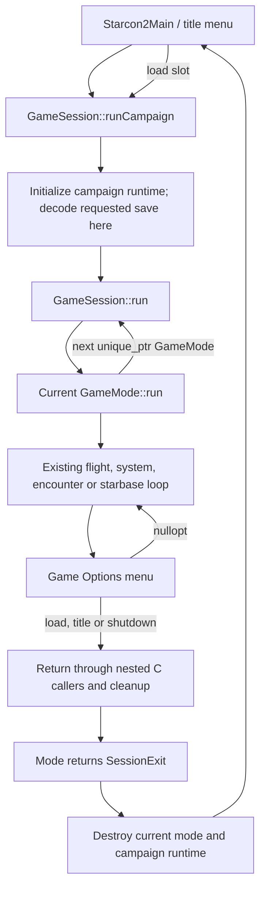

# Synchronous modes, menus, and load boundaries

The production dispatcher is now in `sc2/src/uqm/game_mode.*` and
`gameplay_modes.cpp`. This replaces the earlier proposal to handle synchronous
loads using session epochs and shared orbital policies. A load does not replace
state underneath a running story handler.

## Implemented control flow

GameMode owns shared GameState lifetime and a checked PlayerId. Its synchronous
run method returns `variant<unique_ptr<GameMode>, SessionExit>`. The dispatcher
replaces the current mode only after run returns, so transitions do not accumulate
stack frames. A successor must be non-null. Invalid transitions and native C++
exceptions produce a Failed exit after the current mode is destroyed.

Concrete adapters cover HyperSpace/QuasiSpace, solar-system exploration, encounters
(including starbases and bomb installation), title-selected loading, and debug
hooks. Existing orbital, lander, conversation and battle loops remain inside
these adapters; they have not all become independent modes.

The native Game Options entry returns `optional<SessionExit>`. nullopt means the
menu closed normally and its caller can resume. A value must propagate outward.
Save remains an ordinary menu action and does not destroy the running world.

## C compatibility and pending exits

C menus still use their existing input callbacks and Boolean return values.
GameOptions translates the native optional into a session-owned pending exit and
CHECK_LOAD/CHECK_ABORT unwind flags. Enclosing C loops perform their established
cleanup and return. They do not decode another campaign while running.

The pending exit retains the selected save slot independently of flags that old
callers clear or overwrite. Shutdown takes priority over failure, load and title;
the first request wins at equal priority. Requests are gameplay-thread operations,
not a thread-safe message queue. The dispatcher clears them when a run ends.

Selecting a load performs a read-only save-summary preflight. Actual LoadGame
payload decoding happens in the next runCampaign call, after the previous mode,
nested calls, clock, queues and campaign resources have been torn down. The
process-lifetime GameState storage remains stable for legacy C pointers; the
legacy initializer and decoder rebuild its payload in place.

## Failures and remaining work

No exception is used to jump through C gameplay frames. C entry adapters catch
native exceptions and translate them into flags/results. Native dispatcher errors
are logged and return to the title menu. Destructors release resources; they do
not publish gameplay progress.

The legacy decoder is not transactional. Summary preflight catches unavailable
or invalid summaries before unwinding. A later payload failure discards the fresh
partial campaign and returns to title; it cannot resume the old campaign. A
candidate-state decoder is separate future work, as is a new portable save schema.

## Next world-behavior migration

WorldBehavior can retain the conventional unique_ptr ownership already sketched
in world.hpp. Orbital action selection should read live campaign/world state and
return typed data. An orbital runner owns its temporary encounter/UI resources
and propagates session exits instead of resuming story completion after load.
Existing C handlers still inspect unwind flags during this incremental migration.
Their queue ownership must be audited before wrapping those resources in RAII.

A shared immutable orbital policy or session epoch is not required to solve the
current synchronous load path. If future asynchronous operations can outlive a
session, give those operations an explicit cancellation/identity contract then.
Networking, concurrent simulation and orbital handler conversion are not part of
this dispatcher change.

## Verification

Boost.Test covers 10,001 flat transitions, successor destruction, slot zero,
pending menu exits and shutdown priority, malformed exits, null successors,
exception cleanup and dispatcher reuse. Debug/Release CTest, the legacy build,
and the full AddressSanitizer/UndefinedBehaviorSanitizer suite pass.

A private-config GUI smoke test starts a new game at Sol, saves slot zero,
cancels the load picker without leaving the campaign, accepts a load back into
flight, and exits through the confirmation menu to title. This is a focused
control-flow check, not a complete gameplay or corrupt-save compatibility audit.
