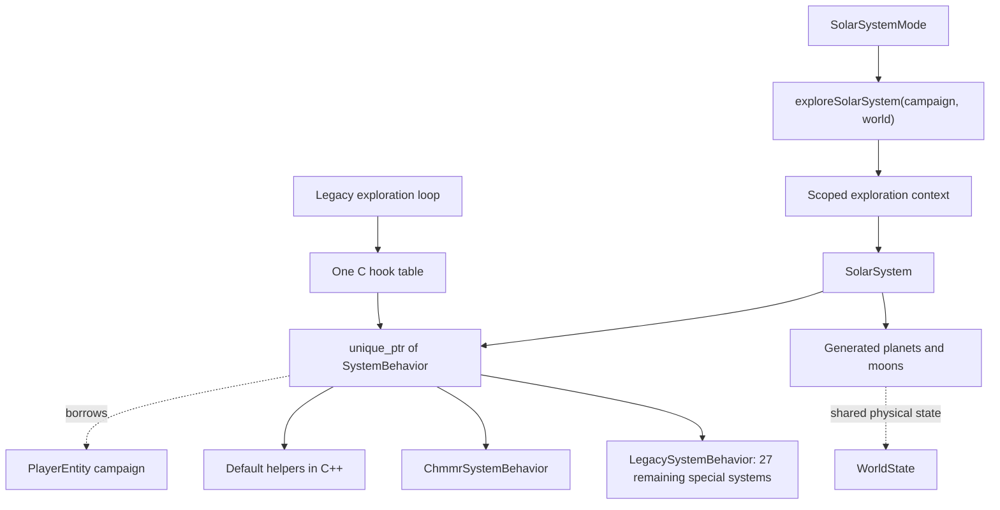

# System behavior: first production migration

The active exploration runtime now owns one `SolarSystem`, which owns a
`unique_ptr<SystemBehavior>`. The behavior borrows `CampaignState&`; physical
world progress continues to use shared `WorldState` ownership. No campaign state
is copied or shared between sessions by this change.

## Lifetime and generation order

`SolarSystemMode` passes its player's campaign reference and shared world owner to
`exploreSolarSystem`. That native entry owns the opaque context on its stack.
The existing C loop resolves the current star, attaches the borrowed context,
and creates the system/behavior **before** calling any generation hooks.

After `generatePlanets`, `BuildSystemWorlds` attaches the generated planet
layout to the existing owner. It no longer destroys and recreates the runtime.
Moon generation still populates the existing native world children afterward.
Hook order, return conventions, RNG consumption, and C descriptor layout remain
as before. A rejected planet layout leaves the existing native layout unchanged.

The C exploration loop completes `UninitSolarSys` and returns before the scoped
context destroys its system, worlds, and behavior. The enclosing mode retains
the GameState owner, so the borrowed campaign outlives all these objects. Loads
continue to wait for mode/menu unwinding.

Legacy debug universe traversal retains paired `CreateSystemWorlds` /
`DestroySystemWorlds` adapters. Only that compatibility entry obtains the active
campaign globally; production exploration receives it explicitly from its mode.
It uses the same behavior dispatch, including Chmmr. Do not call the owning
Destroy adapter on the stack-borrowed production context.

## Dispatch and migration boundary

`SystemBehavior` provides all 13 existing hooks with reference-based descriptor
parameters. Default implementations call the existing shared algorithms, now
compiled as C++ in `gendefault.cpp`. Those helpers keep C linkage because the
unmigrated tables still call them. Their story accesses (battle planet and Yehat
civil war) use the campaign reference attached to the explicit system context.
The generated descriptor arguments must belong to that behavior's active system.

`ChmmrSystemBehavior` overrides only planet generation, moon generation, and
orbital handling. Its story reads/writes use the inherited `CampaignState&`:
Chmmr liberation, Sun Device, Ilwrath deception, bomb progress, and encounter
context. Conditions are read when hooks execute, not cached at construction.
Its old function table is removed.

The factory selects Chmmr by the catalogue's special-system ID. Ordinary systems
use the default class. The remaining 27 special-system implementations retain
their tables through `LegacySystemBehavior`; their global story accesses have
**not** yet migrated. There is no global current-behavior pointer or new registry.

The single C bridge table translates existing `SOLARSYS_STATE*` calls into native
virtual calls using the context already on that descriptor. Native classes never
dispatch back into that bridge. As before, invalid world-adapter context or an
exception at this legacy C boundary aborts; this does not introduce graceful
recovery for C allocation/resource failures.

## What remains procedural

Chmmr orbital actions still call existing communication, resource, activity-flag,
and encounter-queue routines. Planet calculations, rendering, landers, and NPC
queues remain in their existing engine. This migration makes the campaign
reference and behavior lifetime explicit; it does not make exploration concurrent,
headless, or independent of the process-wide legacy engine.

No conversation implementation or save encoding changes. New typed identifiers
map onto the existing authoritative packed fields; the generic campaign interface
has not grown a method per story field.

## Verification

Boost.Test uses the real factory, Chmmr overrides, campaign storage, runtime
ownership and C bridge, with fake default-generation and encounter/UI services.
It checks separate campaigns, hook-time flag changes, shielding, orbital fallback,
Chmmr/Ilwrath dispatch, encounter context, default-hook forwarding, legacy-table
forwarding, stable behavior identity and atomic layout validation. The existing
C discovery/save integration fixture also uses the new construction order.
These dependency fakes do not prove terrain or dialogue rendering correctness.

Debug/Release CMake/Ninja, legacy build and ASan/UBSan checks are recorded in the
PR. A focused new-game GUI smoke check entered Sol through the legacy adapter;
Chmmr story branches are covered by the dependency-isolated regression tests.

## Sources

- [Native behavior interface/factory](../../../sc2/src/uqm/system_behavior.hpp)
- [Scoped exploration entry](../../../sc2/src/uqm/system_runtime.cpp)
- [World owner](../../../sc2/src/uqm/world.hpp)
- [C hook bridge](../../../sc2/src/uqm/world_c.cpp)
- [Chmmr overrides](../../../sc2/src/uqm/planets/generate/genchmmr.cpp)
- [Shared default helpers](../../../sc2/src/uqm/planets/generate/gendefault.cpp)
