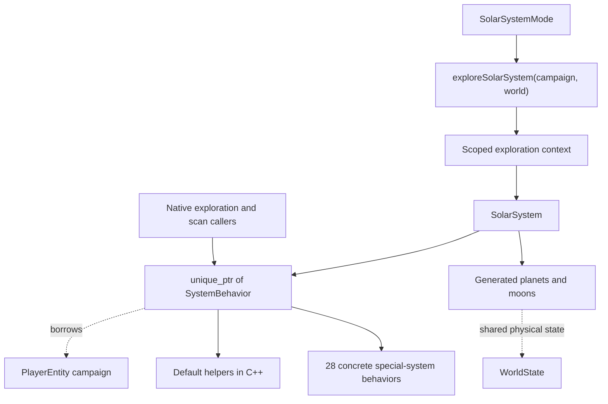

See the [current runtime encapsulation map](../runtime-encapsulation.md) for the
exploration/navigation/encounter/lander ownership. This document focuses on
the native behavior interface and migration contracts.

# Native system behaviors

The active exploration runtime now owns one `SolarSystem`, which owns a
`unique_ptr<SystemBehavior>`. The behavior borrows `StoryState&`; physical
world progress continues to use shared `WorldState` ownership. No campaign state
is copied or shared between sessions by this change.

## Lifetime and generation order

`SolarSystemMode` passes its player's campaign reference and shared world owner to
`exploreSolarSystem`. That native entry owns the opaque context on its stack.
The native exploration entry resolves the current star, attaches the borrowed context,
and creates the system/behavior **before** calling any generation hooks.

After `generatePlanets`, `BuildSystemWorlds` attaches the generated planet
layout to the existing owner. It no longer destroys and recreates the runtime.
Moon generation still populates the existing native world children afterward.
Hook order, return conventions, RNG consumption, and C descriptor layout remain
as before. A rejected planet layout leaves the existing native layout unchanged.

The native exploration scope completes `UninitSolarSys` and returns before the scoped
context destroys its system, worlds, and behavior. The enclosing mode retains
the GameState owner, so the borrowed campaign outlives all these objects. Loads
continue to wait for mode/menu unwinding.

Legacy debug universe traversal retains paired `CreateSystemWorlds` /
`DestroySystemWorlds` adapters. Only that compatibility entry obtains the active
campaign globally; production exploration receives it explicitly from its mode.
It uses the same behavior dispatch, including Chmmr. Do not call the owning
Destroy adapter on the stack-borrowed production context.

## Dispatch and migration boundary

`SystemBehavior` provides all 13 existing hooks with reference-based descriptor
parameters. Default implementations call the existing shared algorithms, now
compiled as C++ in `gendefault.cpp`. Those helpers keep C linkage because the
unmigrated tables still call them. Their story accesses (battle planet and Yehat
civil war) use the campaign reference attached to the explicit system context.
The generated descriptor arguments must belong to that behavior's active system.

`ChmmrSystemBehavior` overrides only planet generation, moon generation, and
orbital handling. Its story reads/writes use the inherited `StoryState&`:
Chmmr liberation, Sun Device, Ilwrath deception, bomb progress, and encounter
context. Conditions are read when hooks execute, not cached at construction.
Its old function table is removed.

The native factory covers all 45 catalogue special-system IDs, including aliases
that share rules. Ordinary systems use the base class; all 28 special-system
implementations are native derived classes. The remaining 27 generator sources
were converted to C++ with the same hook selections and procedural algorithms.
Their private helpers are members where they need campaign access.

All direct story macro accesses in these files are replaced with the borrowed
campaign reference. The generic interface gains typed identifiers and metadata,
not a method per story field. Four-byte NPC group offsets retain the original
32-bit packed encoding; Melnorme's dynamic offset selector returns an optional
typed counter instead of an untyped bit offset.

The old per-system tables, `LegacySystemBehavior`, the default function table,
and `gendef.c` selector are removed. Default helper functions keep C-compatible
signatures for now, but only native behavior methods call them.

The generator C bridge table, genFuncs field, and generate.h have since been
removed. Native exploration/scanning/debug callers dispatch directly. Catalogue
and session context are attached before hooks; system conversations now run as
nested child modes.

## What remains procedural

System orbital actions use a native child mode around existing communication,
plus scoped temporary-fleet cleanup. Resource operations and activity flags still
use the legacy backend. Planet calculations, rendering and NPC queues remain
procedural; a native LanderVisit now owns launch state. This migration makes the campaign
reference and behavior lifetime explicit; it does not make exploration concurrent,
headless, or independent of the process-wide legacy engine.

No conversation implementation or save encoding changes. New typed identifiers
map onto the existing authoritative packed fields; the generic campaign interface
has not grown a method per story field.

## Verification

Boost.Test uses the real factory, Chmmr/Syreen overrides, campaign storage, runtime
ownership and C bridge, with fake default-generation and encounter/UI services.
It checks separate campaigns, hook-time flag changes, shielding, orbital fallback,
Chmmr/Ilwrath dispatch, encounter context, default-hook forwarding, catalogue ID mapping, packed-field and 32-bit compatibility, stable behavior identity and atomic layout validation. The existing
C discovery/save integration fixture also uses the new construction order.
These dependency fakes do not prove terrain or dialogue rendering correctness.

Debug/Release CMake/Ninja, legacy build and ASan/UBSan checks are recorded in the
PR. A focused new-game GUI smoke check entered Sol through the legacy adapter;
Chmmr/Syreen branches are covered by dependency-isolated regression tests. Other
system builders are faked in factory tests; the full game build links all actual
implementations. A source audit verifies all 108 migrated override selections
against the original 27 function tables.

## Sources

- [Native behavior interface/factory](../../../sc2/src/uqm/system_behavior.hpp)
- [Scoped exploration entry](../../../sc2/src/uqm/system_runtime.cpp)
- [World owner](../../../sc2/src/uqm/world.hpp)
- [World/archive compatibility](../../../sc2/src/uqm/world_c.cpp)
- [Chmmr overrides](../../../sc2/src/uqm/planets/generate/genchmmr.cpp)
- [Shared default helpers](../../../sc2/src/uqm/planets/generate/gendefault.cpp)

The [nested mode API](../nested-modes.md) now runs orbital system encounters
through a child mode, preserving synchronous dialogue and combat internals.
