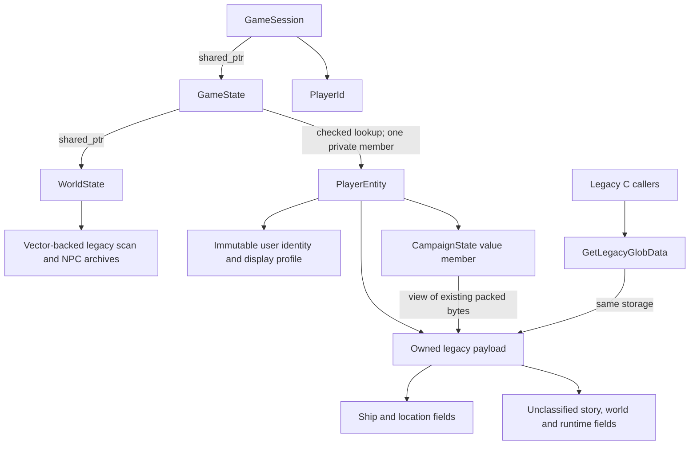

# Player state: first production integration

`sc2/src/uqm/game_state.hpp` provides a C++17 state ownership boundary. The game
uses it today through the C compatibility adapter in `globdata.h`. WorldState
now owns the legacy scan/NPC file archives separately from the player. The
remaining world/behavior architecture is documented in
[the target wireframe](design/solar-system/README.md).



## Access and ownership

GameState initially owns exactly one player. `player(PlayerId)` checks identity
and throws `std::out_of_range` when absent. A session rejects null state and
unknown players at construction, retains its shared owner, and repeats lookup
when accessing its player. It does not cache a player pointer. A collection can
replace the private member later without exposing its representation to sessions.

PlayerEntity owns one zero-initialized payload for its lifetime. CampaignState
is a noncopyable value member viewing the packed story fields in that payload.
It cannot be independently constructed or rebound. Ship and location queries
return detached C++ values, not legacy pointers or another editable live store.
Profile display name is account-level metadata; CommanderName remains the
in-game captain name. Typed setters validate counter ranges before mutation;
constant counter assignments can be checked at compile time:

```cpp
auto state = std::make_shared<uqm::GameState>(
        uqm::UserProfile{uqm::PlayerId{1}, "Captain"});
uqm::GameSession session{state, uqm::PlayerId{1}};
auto &campaign = session.player().campaign();
campaign.set(uqm::StoryFlag::SunDeviceOnShip);
campaign.set<uqm::StoryCounter::BombProgress, 3>(); // 4 is a compile error.
```

The native header contains no legacy C headers. Equipment arrays use standard
containers and legacy dimensions are checked at compilation. Name copies are
bounded even when a loaded fixed-size name lacks a terminating NUL. Native fuel
and crew setters change stored quantities only; gameplay still checks costs and
capacity. Native player operations are simulation-thread confined. shared_ptr preserves
lifetime; it adds no synchronization to legacy C access or native mutations.

## Legacy compatibility

The old global variable definition is removed. `GlobData` is now a C adapter
expression resolving to the active session's player-owned payload. Existing
member access, address-taking, assignment and `sizeof` expressions remain valid.
The GLOBDATA/GAME_STATE/SIS_STATE layouts and save encoders/decoders are unchanged.
There is no copy between C and C++ state when accessing data.

The process-lifetime session is initialized on first use. Legacy ship resource
code can retain its payload address. InitGlobData still clears only the plain C
payload in place; it cannot erase the C++ owner, profile, or campaign view.
Existing resource/queue cleanup must still run before state destruction. This
step establishes ownership of the record, not RAII for every handle it contains.

Packed-state helpers moved from globdata.c into game_state_bits.c so both native
state methods and the legacy game use the same implementation. The 32-bit reader
and copy source are const-correct. The reader casts to unsigned DWORD before
shifting its high byte, avoiding signed-shift overflow. Debug-state copying
supplies the required diagnostic name.

## Shared world archive integration

GameState holds a non-null shared_ptr<WorldState>, which sessions access without
knowing its storage. Separate player states can share an explicit world owner.
WorldState owns all three legacy state-file records; the former process-global
state_files array and its HMalloc/HRealloc/HFree growth code are removed. Vector
growth preserves handle addresses. C functions keep their existing names and
serialized byte layout; native snapshots return copied file contents.

World snapshot/restore is coherent under a world mutex. Restore validates its
universe ID and file sizes, and refuses while any C file is open. Individual C
operations are locked, but the shared seek cursor means complete multi-call I/O
sequences still require simulation-thread confinement. These locks do not make
the entire game or legacy cursor API safe for concurrent simulation.

Reads now stop at logical EOF rather than allocation capacity. Zero-sized I/O
returns zero instead of dividing by zero. Seek arithmetic rejects overflow and
writes beyond EOF zero-fill gaps. Obsolete fixed capacity estimates and manual
growth multipliers are deleted. Existing save/load continues to manage its
original files and encoding.

**The archive is still semantically mixed.** Androsynth energy bits encode
personal report history, and encounter archives require their own scope audit.
The new [discovery-state wireframe](design/solar-system/discovery-state.md)
separates physical depletion, personal visits, and item possession. The raw archive
must not become the multiplayer sharing policy merely because it has a shared
owner. Production remains single-player.

## Remaining migration

The legacy record still mixes personal and shared state. Its temporary placement
inside PlayerEntity does not classify all its contents as personal. Multiple
independent GameState objects are useful for ownership tests, but do not yet
represent players inhabiting a shared universe.

Next, split semantic fields inside the legacy archives and GLOBDATA into shared
world progress and personal storage while adapting save/load and C callers. Collection rewards need a coordinated
personal/shared operation before multiple players can interact. The target world
and behavior hierarchy, typed world-progress persistence, public presence, networking,
and cross-process authority are not implemented by this change. Worker mutation
would require a player synchronization boundary and snapshot-based access.

Verification includes native ownership/const-access checks, genuine C macro
writes observed by C++, native writes observed by C, packed-field boundaries,
whole-aggregate reset/restore address stability, bounded name conversion, legacy
state-file I/O and native/C snapshot round trips, and coherent snapshots under
concurrent whole-world restores.
Aggregate restore tests exercise the compatibility contract; they do not replace
an end-to-end gameplay save/load test.
